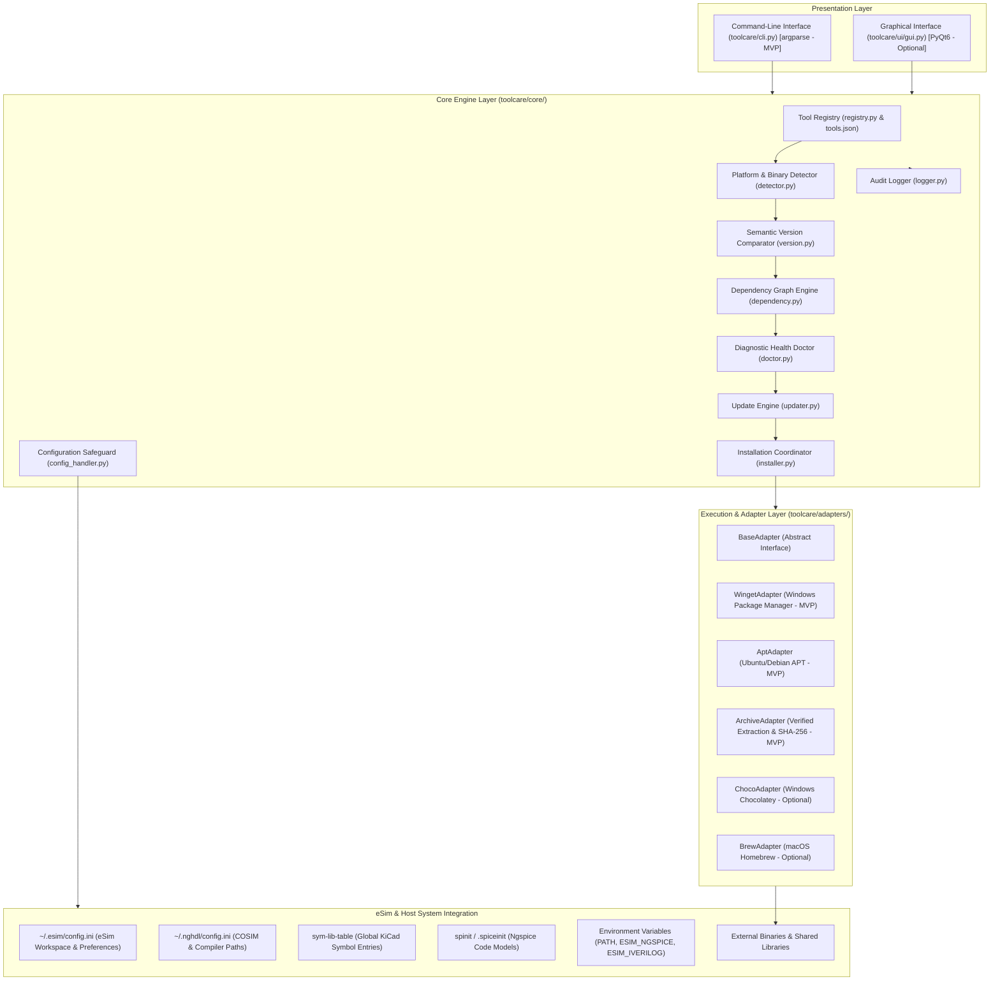
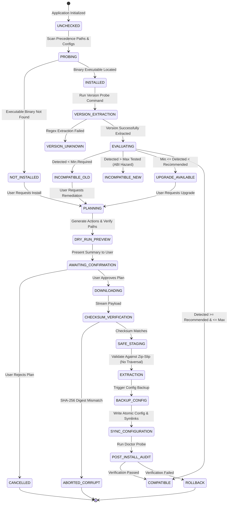
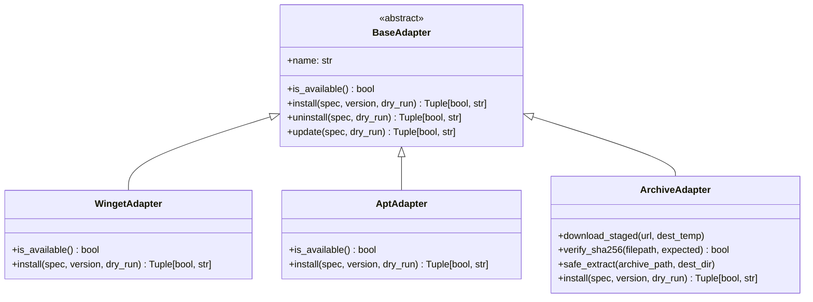

# Design Document: eSim ToolCare
## Automated Tool, Dependency & Configuration Manager for eSim

**FOSSEE eSim Semester Long Internship – Autumn 2026**  
**Screening Task 5: Tool Manager (CSE and related fields)**  
**Target Platform:** Windows 10/11 64-bit (Primary Development & Demonstration), Ubuntu 24.04/26.04 LTS (Architecture-Compatible)  
**Target Repository:** `FOSSEE/eSim` (`feature/esim-toolcare` branch)  
**Submission Target:** Private Candidate Repository (Access granted to `Eyantra698Sumanto`, emailed to `contact-esim@fossee.in`)  
**Submission Deadline:** November 23, 2026  
**Document Version:** 2.0.0 (Submission-Readiness Specification)  
**Status:** Architecture Locked & Implementation Ready  

---

## 1. Executive Summary & Problem Formulation

### 1.1 Background & Context
**eSim** is an open-source Electronic Design Automation (EDA) platform developed by the FOSSEE team at IIT Bombay. It provides an end-to-end environment for schematic capture, analog/digital/mixed-signal circuit simulation, and Printed Circuit Board (PCB) design. 

Rather than implementing every EDA solver from scratch, eSim integrates established third-party tools:
* **KiCad** (`eeschema` schematic editor, `pcbnew` layout designer, symbol and footprint libraries)
* **Ngspice** (SPICE-based analog and mixed-signal simulation engine)
* **Icarus Verilog** (`iverilog` compiler and `vvp` runtime engine)
* **GHDL** (VHDL analyzer and simulation toolchain)
* **Verilator** (Cycle-accurate Verilog/SystemVerilog simulator and C++ model generator)
* **LLVM / Clang / GCC & Make** (Compilation toolchains for synthesizing dynamic code-model `.cm` libraries)
* **OpenModelica** (`omc` equation-based multi-domain physical simulation engine)
* **FreeCAD** (Parametric 3D CAD modeler for 3D PCB visualization)
* **Makerchip / Sandpiper** (Cloud/local Verilog and TL-Verilog pipeline IDE)

---

### 1.2 Distinguishing Existing eSim from Proposed ToolCare
To ensure architectural integrity, this document strictly differentiates between what the eSim repository **currently provides** and what **eSim ToolCare introduces**:

```
+-------------------------------------------------------------------------------------------------------+
|                                    EXISTING ESIM ECOSYSTEM                                            |
|                                                                                                       |
|  * Monolithic Installers: Ubuntu/install-eSim.sh (APT/source builds) & windows/build-windows.ps1     |
|  * Static Manifests: windows/deps-manifest.json (pins Python, Ngspice, KiCad, MSYS2)                  |
|  * Startup Bootstrap: windows/windows_bootstrap.py (seeds ~/.esim, ~/.nghdl, spinit, sym-lib-table)   |
|  * Diagnostic Probes: src/maker/ToolchainCheck.py (probes ngspice, ivlng, libvvp, GHDL backend)     |
|  * Runtime Invocation: src/projManagement/Worker.py (QThread/QProcess wrapping subprocess.Popen)      |
+-------------------------------------------------------------------------------------------------------+
                                                   │
                                     (Bridged & Extended By)
                                                   ▼
+-------------------------------------------------------------------------------------------------------+
|                                   PROPOSED ESIM TOOLCARE SYSTEM                                       |
|                                                                                                       |
|  * Central Declarative Registry: toolcare/data/tools.json (Version constraints, package IDs, hashes)  |
|  * Automated Tool & Dependency Detector: toolcare/core/detector.py & toolcare/core/dependency.py      |
|  * Dedicated Update Engine: toolcare/core/updater.py (Version polling, update plans, dry-run)         |
|  * Configuration Safeguard: toolcare/core/config_handler.py (Backups, atomic writes, rollback)        |
|  * Safe Multi-Tier Installer: toolcare/core/installer.py (Winget, APT, Archive adapters, Zip-Slip safe)|
|  * Lightweight CLI & Aurora GUI: toolcare/cli.py (argparse MVP) + toolcare/ui/gui.py (PyQt6)          |
+-------------------------------------------------------------------------------------------------------+
```

---

### 1.3 The Core Problem Statement in eSim Today
Managing external EDA tools manually or through generic OS package managers creates critical points of failure:

1. **Sub-Dependency and ABI Mismatches:**
   * **Ngspice XSPICE & `ivlng`:** Standard Linux distributions or Windows binaries distributed by upstream package managers frequently lack XSPICE code models or the `ivlng` dynamic bridge adapter required for Verilog co-simulation (`d_cosim`).
   * **Icarus Verilog `libvvp`:** Generic packages (such as `apt install iverilog` or standard Bleyer Windows installers) omit `libvvp.so` / `libvvp.dll`. Because Ngspice's `ivlng` adapter dynamically loads `libvvp` via `dlopen`/`LoadLibrary`, simulations fail with missing-symbol linker errors.
   * **GHDL LLVM Backend Trap:** Installing generic GHDL packages on Ubuntu often pulls `ghdl-mcode`. The `mcode` backend cannot interface with the NGHDL IPC socket server, leading to silent simulation hangs. eSim requires `ghdl-llvm`.
   * **Verilator Version Drift:** eSim requires Verilator 5+ for modern C++ testbench generation (Verilator 4 in older Ubuntu releases is incompatible).

2. **Configuration and Symbol Table Drift:**
   * Installing KiCad does not automatically link eSim's custom symbol libraries (`eSim_Subckt`, `eSim_Ngveri`, `eSim_NgVeriCosim`, `eSim_Nghdl`) into KiCad's global `sym-lib-table`.
   * Installing Ngspice does not automatically inject required `codemodel` paths into `spinit` or `.spiceinit`.
   * Environment variables (`ESIM_NGSPICE`, `ESIM_IVERILOG`, `PATH`) are left unset, causing eSim to fall back to legacy system defaults.

3. **Absence of a Non-Destructive Update & Health Audit Subsystem:**
   * Users have no automated mechanism to check if newer versions are available, preview changes before installation, verify file integrity, or roll back breaking tool updates without reinstalling the entire eSim application.

---

## 2. Requirements Traceability Matrix & MVP Scoping

To guarantee delivery of a robust, fully tested prototype before the **November 23, 2026** deadline, the requirements are organized into three distinct priority tiers:

| Requirement ID | Screening Task Requirement | Implementation in eSim ToolCare | Implementation Module | Priority Tier |
| :--- | :--- | :--- | :--- | :--- |
| **REQ-1** | **Tool Installation Management:**<br>• Automated download & install<br>• Linux/Windows compatibility<br>• Version control & constraint enforcement | • Multi-tier installation engine using verified package managers (`winget`, `apt`) and direct vendor archives.<br>• OS abstraction layer.<br>• SemVer boundary enforcement ($V_{\text{min}} \le V \le V_{\text{max}}$). | `core/installer.py`<br>`adapters/winget_adapter.py`<br>`adapters/apt_adapter.py`<br>`adapters/archive_adapter.py` | **Priority 1 (Mandatory MVP)** |
| **REQ-2** | **Update and Upgrade System:**<br>• Check for updates for tools & libraries<br>• Minimal manual intervention updates<br>• Safe pre-update planning | • Dedicated updater engine.<br>• Generates structured update plans.<br>• Supports `--check` and `--dry-run`.<br>• Mandatory user confirmation.<br>• Post-update verification. | `core/updater.py`<br>`core/version.py` | **Priority 2 (Core Capability)** |
| **REQ-3** | **Configuration Handling:**<br>• Predefined & user setting automation<br>• Environment variable & PATH management<br>• Seamless eSim integration | • Automatic synchronization of `~/.nghdl/config.ini`.<br>• Injects eSim symbols into KiCad `sym-lib-table`.<br>• Configures Ngspice `spinit` codemodels.<br>• Automatic `.bak` backups before modifying any file.<br>• Atomic writes via `atomic_write`. | `core/config_handler.py` | **Priority 2 (Core Capability)** |
| **REQ-4** | **Dependency Checker:**<br>• Check & manage necessary dependencies<br>• User feedback on missing/incompatible pieces | • Explicit dependency graph engine.<br>• Diagnostic Doctor auditing 5 stages (Host, Analog, Digital, VHDL, Config).<br>• Validates shared libraries (`libvvp`, `ivlng`, `ghdl.cm`). | `core/dependency.py`<br>`core/doctor.py` | **Priority 1 (Mandatory MVP)** |
| **REQ-5** | **User Interface:**<br>• Simple, user-friendly CLI & GUI<br>• View installed tools, versions, updates<br>• Action & audit logging | • Lightweight, dependency-free CLI using Python standard library `argparse`.<br>• Persistent rotating audit log (`~/.esim/logs/toolcare.log`).<br>• Optional PyQt6 graphical interface. | `cli.py`<br>`logger.py`<br>`ui/gui.py` (Opt) | **Priority 1 (CLI)**<br>**Priority 3 (GUI)** |
| **REQ-6 (Opt)** | **Additional Features:**<br>• Cross-platform support<br>• Integration with popular package managers | • Extensible adapter pattern.<br>• Windows (Winget) as primary tested MVP target.<br>• Ubuntu (APT) architecture-compatible.<br>• Chocolatey and Homebrew marked as optional future extensions. | `adapters/base.py`<br>`platform_utils.py` | **Priority 1 (Winget/Archive)**<br>**Priority 3 (Choco/Brew)** |

---

## 3. High-Level Architecture & Workflows

### 3.1 Layered Architecture Overview
The system is divided into four strictly decoupled layers. The Core Management Layer is written using Python's standard library to guarantee execution even in restricted, minimal environments:



---

### 3.2 Tool Lifecycle State Machine
Every tool managed by ToolCare transitions through predictable, deterministic states:



---

### 3.3 End-to-End Update & Configuration Sequence
The sequence below illustrates the safeguards executed during an update operation:

```mermaid
sequenceDiagram
    autonumber
    actor User as User / CLI
    participant Upd as Updater (updater.py)
    participant Det as Detector (detector.py)
    participant Dep as Dependency Engine (dependency.py)
    participant Inst as Installer (installer.py)
    participant Adp as Winget / Archive Adapter
    participant Cfg as Config Handler (config_handler.py)
    participant Doc as Doctor (doctor.py)
    participant File as Filesystem / OS

    User->>Upd: toolcare update ngspice [--check | --dry-run]
    Upd->>Det: detect_tool("ngspice")
    Det-->>Upd: Currently Installed: v42.0 (Path: C:\Spice64\bin\ngspice.exe)
    Upd->>Upd: Query Available Upstream: v45.2 (Recommended: 45.2, Min: 38.0)
    Upd->>Dep: check_dependents("ngspice")
    Dep-->>Upd: Required by: [d_cosim, nghdl, simulation]
    
    Upd->>Upd: Generate Update Plan (Actions, Source, Target Version, Backups)
    
    alt Flag is --check or --dry-run
        Upd-->>User: Display Update Plan (No Filesystem Changes Made)
    else Live Update Execution
        Upd-->>User: Prompt: "Upgrade ngspice 42.0 -> 45.2? [y/N]"
        User->>Upd: "y" (Confirmed)
        
        Upd->>Cfg: create_backup("all")
        Cfg->>File: Copy config files -> ~/.esim/backups/<timestamp>/
        Cfg-->>Upd: Backup Created OK

        Upd->>Inst: execute_update("ngspice", target_ver="45.2")
        Inst->>Adp: install_package_or_archive(spec)
        Adp->>File: Download to Staging Temp Dir
        Adp->>Adp: Verify SHA-256 Checksum
        Adp->>File: Unpack to destination (Safe Path Validation)
        Adp-->>Inst: Extraction Success
        Inst-->>Upd: Binary Updated OK

        Upd->>Cfg: sync_nghdl_config()
        Cfg->>File: Atomic write ~/.nghdl/config.ini [COSIM]
        Upd->>Cfg: configure_ngspice_spinit()
        Cfg->>File: Atomic write spinit (codemodel paths)
        Cfg-->>Upd: Configuration Synced

        Upd->>Doc: run_tool_diagnostics("ngspice")
        Doc->>File: Probe new binary + ivlng + code models
        Doc-->>Upd: Verification Report (All Probes Passed)
        
        alt Verification Fails
            Upd->>Cfg: rollback_from_backup()
            Upd-->>User: Update Failed Post-Check; Rolled back safely.
        else Verification Succeeds
            Upd->>File: Record history in ~/.esim/logs/update_history.json
            Upd-->>User: Successfully Updated & Verified ngspice to v45.2
        end
    end
```

---

## 4. Module Breakdown & Detailed Specifications

### 4.1 Tool Registry Subsystem (`core/registry.py` & `data/tools.json`)

The Registry acts as the declarative catalog. To prevent breaking eSim runtime co-simulation, all metadata entries are strictly verified against the actual repository files (`windows/deps-manifest.json`, `PACKAGING.md`, `Ubuntu/install-eSim.sh`). Any unverified field is explicitly flagged as `UNVERIFIED`.

#### Verified Registry Schema & Tool Metadata Table:

| Tool ID | Name & Category | Supported OS | Executables | Version Detection Cmd & Regex | Min / Rec / Max Version | Verified Package Identifiers | Direct Archive Source (Verified Hash) | Required Sub-Components & eSim Constraints |
| :--- | :--- | :--- | :--- | :--- | :--- | :--- | :--- | :--- |
| `ngspice` | **Ngspice Simulator**<br>(Analog) | Windows, Linux | `ngspice.exe`, `spice64.exe`<br>Linux: `ngspice` | `--version`<br>`ngspice.*?([0-9]+(?:\.[0-9]+)*)` | **Min:** 38.0<br>**Rec:** 45.2<br>**Max:** 46.0 | Winget: `Ngspice.Ngspice`<br>APT: `ngspice`<br>*(Note: Generic packages lack eSim code-models)* | SourceForge Archive:<br>`ngspice-45.2_64.7z`<br>SHA-256:<br>`6a0c44056e7f...`<br>*(From deps-manifest.json)* | **Critical:** Must have `/lib/ngspice/` containing XSPICE `.cm` files, `ivlng` adapter for Verilog, and `ghdl.cm` for VHDL. |
| `kicad` | **KiCad EDA Suite**<br>(Core) | Windows, Linux | `kicad.exe`<br>Linux: `kicad` | `--version`<br>`([0-9]+\.[0-9]+(?:\.[0-9]+)?)` | **Min:** 7.0.0<br>**Rec:** 9.0.3<br>**Max:** 9.9.9 | Winget: `KiCad.KiCad`<br>APT: `kicad` (PPA on 24.04, universe on 25.04) | Official KiCad Mirror:<br>`kicad-9.0.3-x86_64.exe`<br>SHA-256:<br>`582635ced855...`<br>*(From deps-manifest.json)* | **Critical:** Requires eSim symbol libraries (`eSim_Subckt`, `eSim_Ngveri`, `eSim_Nghdl`) registered in `sym-lib-table`. KiCad < 7 is incompatible. |
| `iverilog` | **Icarus Verilog**<br>(Digital) | Windows, Linux | `iverilog.exe`<br>Linux: `iverilog` | `-V`<br>`version ([0-9]+(?:\.[0-9]+)*)` | **Min:** 10.0<br>**Rec:** 12.0<br>**Max:** 13.0 | Winget: `UNVERIFIED`<br>APT: `iverilog` | Bleyer Windows Setup:<br>`iverilog-v12-...setup.exe`<br>SHA-256:<br>`a614057374df...` | **Critical:** `d_cosim` requires `libvvp` (`libvvp.so` / `libvvp.dll`). APT iverilog lacks `libvvp` unless built from source with `--enable-libvvp`. |
| `ghdl` | **GHDL VHDL Simulator**<br>(Digital) | Windows, Linux | `ghdl.exe`<br>Linux: `ghdl` | `--version`<br>`GHDL\s+([0-9]+(?:\.[0-9]+)*)` | **Min:** 2.0.0<br>**Rec:** 4.1.0<br>**Max:** 5.5.0 | Winget: `UNVERIFIED`<br>APT: `ghdl-llvm` | MSYS2 Mingw64 Package:<br>`mingw-w64-x86_64-ghdl-llvm`<br>*(Pinned in deps-manifest)* | **Critical:** MUST use LLVM backend. The `mcode` backend crashes eSim socket co-simulation. |
| `verilator` | **Verilator Simulator**<br>(Digital) | Windows, Linux | `verilator.exe`<br>Linux: `verilator` | `--version`<br>`Verilator\s+([0-9]+\.[0-9]+)` | **Min:** 5.006<br>**Rec:** 5.032<br>**Max:** 5.999 | Winget: `UNVERIFIED`<br>APT: `verilator` | MSYS2 Mingw64 Package:<br>`mingw-w64-x86_64-verilator` | Verilator 4 is unsupported; requires Verilator 5+ for C++ testbench compilation. |
| `llvm` | **LLVM / Clang**<br>(System) | Windows, Linux | `clang.exe`, `llvm-config.exe`<br>Linux: `clang` | `--version`<br>`clang version ([0-9]+(?:\.[0-9]+)*)` | **Min:** 14.0<br>**Rec:** 18.1.8<br>**Max:** 20.0 | Winget: `LLVM.LLVM`<br>APT: `clang`, `llvm` | Official LLVM GitHub release binary | Required for compiling GHDL LLVM backend models and C++ co-sim bridges. |

---

### 4.2 Detection & Discovery Subsystem (`core/detector.py`)

The detector searches for binaries using eSim's established resolution hierarchy:
1. **Explicit Environment Overrides:** Checks `ESIM_NGSPICE`, `ESIM_IVERILOG`, `KICAD_PATH`, `VERILATOR_ROOT`.
2. **eSim Configuration:** Inspects `~/.nghdl/config.ini` (`[COSIM]`, `[NGHDL]`, `[COMPILER]`).
3. **Bundled eSim Paths:** Inspects `<eSim_Root>/library/bin/`, `<eSim_Root>/tools/`, and MSYS2 mingw64 trees (`C:\msys64\mingw64\bin`).
4. **Standard Operating System Paths:** `C:\Program Files\KiCad\*\bin`, `C:\Spice64\bin`, `/usr/bin`, `/usr/local/bin`.
5. **System PATH:** Uses `shutil.which` as a final fallback.

**Windows Process Isolation:** All execution probes use `subprocess.run` with `creationflags=subprocess.CREATE_NO_WINDOW` and `STARTUPINFO.dwFlags |= subprocess.STARTF_USESHOWWINDOW` (`SW_HIDE`). Console windows never flash during background checks.

---

### 4.3 Dependency Engine & Diagnostic Doctor (`core/dependency.py` & `core/doctor.py`)

#### Dependency Graph (`core/dependency.py`):
eSim is not a monolithic program; different simulation workflows have distinct dependency requirements:
* **Analog Simulation Flow (`simulation`):** Requires `kicad` (schematic) + `ngspice` (with standard code models).
* **Verilog Verifier Flow (`verifier`):** Requires `iverilog` + `vvp`.
* **Verilog Mixed-Signal Co-Simulation (`d_cosim`):** Requires `ngspice` + `ivlng` code model + `iverilog` with `libvvp`.
* **Verilator Code-Model Synthesis (`ngveri`):** Requires `verilator` (v5+) + `gcc`/`make` + `ngspice`.
* **VHDL Co-Simulation (`nghdl`):** Requires `ghdl` (LLVM backend ONLY) + `ghdl.cm` code model + `gcc`/`make` + `ngspice`.

#### Diagnostic Doctor (`core/doctor.py`):
Conducts non-invasive runtime inspection:
1. Probes binary existence and parses SemVer.
2. Audits shared library linkage:
   * Probes for `libvvp.so` / `libvvp.dll` in `<iverilog_prefix>/lib/`.
   * Probes for `ivlng.so` / `ivlng.dll` in Ngspice code-model folder.
   * Probes for `ghdl.cm` in Ngspice code-model folder.
3. Checks GHDL backend: inspects `ghdl --version` output. If `mcode` is detected, flags a critical failure.
4. Returns an actionable `DoctorReport` detailing exact paths probed and one-line resolution instructions.

---

### 4.4 Dedicated Update Engine (`core/updater.py`)

The Update Engine manages tool lifecycle transitions safely without manual intervention:
1. **Version Discovery:** Queries installed version via `detector.py` and compares against available versions from `tools.json` and package managers.
2. **Update Plan Generation:** Constructs an immutable `UpdatePlan` containing:
   * Current version vs Target version.
   * Target package identifier or archive download URL.
   * Required configuration files to backup.
   * Dependent simulation flows affected.
3. **Execution Flags:**
   * `--check`: Non-destructive inspection; prints update availability without altering system state.
   * `--dry-run`: Previews the full sequence of actions (commands, paths, backup targets) without executing them.
4. **Explicit Confirmation:** Interactive CLI requires explicit `[y/N]` user confirmation before modifying binaries.
5. **Post-Update Verification:** Automatically executes `detector.py` and `doctor.py` on the upgraded tool to verify that the binary runs and satisfies eSim sub-dependency rules.
6. **Audit History:** Records update attempts, outcomes, and failure traces in `~/.esim/logs/update_history.json`.

---

### 4.5 Configuration Safety & Rollback Engine (`core/config_handler.py`)

Modifying configuration files carries the risk of corrupting user workspaces. ToolCare enforces strict safety constraints:

1. **Pre-Modification Backups:**  
   Before any configuration write, the target file is copied to:
   `~/.esim/backups/<ISO8601_TIMESTAMP>/<filename>.bak`
2. **Atomic Writes:**  
   All file writes write to a sibling temporary file (`filename.tmp`), flush and sync descriptors (`os.fsync`), and replace the target atomically using `os.replace`.
3. **Preservation of User Settings:**  
   Parses existing `.ini` and S-expression files in memory; existing user keys and comments are preserved. Only eSim-managed sections are touched.
4. **Duplicate Prevention:**
   * **KiCad `sym-lib-table`:** Checks if `(name "eSim_Subckt")` already exists before appending. Replaces stale paths if relocated; never duplicates rows.
   * **Ngspice `spinit`:** Scans for existing `codemodel` directives and updates path strings rather than appending redundant lines.
5. **Rollback Capability:**  
   Provides `config_handler.rollback(timestamp)` to restore verified backup copies if an update or configuration step fails.

---

### 4.6 Installation Safety & Adapter Architecture (`core/installer.py` & `adapters/`)

The installer uses the **Adapter Pattern** with built-in safety controls:



#### Adapter Safeguards:
1. **Subprocess Argument Lists:** Commands are executed strictly as lists (`["winget", "install", "--id", pkg_id]`); raw `shell=True` strings are forbidden.
2. **Cryptographic Checksum Verification:** Archives downloaded by `ArchiveAdapter` are hashed via streaming SHA-256 and matched against the verified digest from `tools.json`. Any mismatch aborts installation immediately.
3. **Zip-Slip & Path Traversal Prevention:** The extraction loop checks every member destination:
   ```python
   # Anti-Zip-Slip validation
   resolved_target = (target_dir / member_name).resolve()
   if not str(resolved_target).startswith(str(target_dir.resolve())):
       raise SecurityError(f"Malicious archive member detected: {member_name}")
   ```
4. **Staging Folders:** Archives are downloaded into a temporary staging folder (`tempfile.mkdtemp`) and extracted only after complete verification.

---

### 4.7 Command-Line Interface (`cli.py`)

The primary interface for the MVP is a clean, scriptable CLI built using Python's standard library `argparse`:

```bash
# General tool discovery and inventory
python -m toolcare list
python -m toolcare list --category analog

# Version and compatibility checking
python -m toolcare check
python -m toolcare check ngspice

# Toolchain diagnostic doctor
python -m toolcare doctor
python -m toolcare doctor --flow dcosim

# Update planning and execution
python -m toolcare update --check
python -m toolcare update ngspice --dry-run
python -m toolcare update ngspice

# Installation of tools
python -m toolcare install ngspice --dry-run
python -m toolcare install ngspice --method archive

# eSim configuration synchronization and rollback
python -m toolcare configure --sync
python -m toolcare configure --rollback <timestamp>

# Audit logs
python -m toolcare logs --lines 100
```

---

## 5. Non-Interference with Existing eSim Code

To ensure eSim's stability, ToolCare adheres to strict boundary constraints:
1. **Zero Replacement of Core Probes:** `src/maker/ToolchainCheck.py` remains untouched. ToolCare imports or mirrors its checks, ensuring `esim --doctor` functions normally.
2. **No Regression in Windows Bootstrap:** `windows/windows_bootstrap.py` and `windows/deps-manifest.json` remain the authoritative reference for bundled releases. ToolCare acts as an external manager for modular updates.
3. **Isolated Codebase:** All ToolCare code lives in `toolcare/`. It interacts with eSim only via filesystem configuration files and environment variables.

---

## 6. Comprehensive Testing Strategy

ToolCare will be validated using an automated `pytest` suite located in `toolcare/tests/`. All external commands and filesystem alterations are mocked to permit fast, deterministic testing across platforms:

| Test Module | Coverage Scope & Assertions |
| :--- | :--- |
| `test_registry.py` | Validates `tools.json` schema, checks for missing required fields, ensures regex strings compile without error, and flags unverified entries. |
| `test_version.py` | Verifies SemVer parsing across non-standard version strings (`45.2`, `v12-20220611`, `9.0.3-rc1`). Asserts correct boundary classification (`INCOMPATIBLE_OLD`, `COMPATIBLE`, `UPGRADE_AVAILABLE`). |
| `test_detector.py` | Tests discovery precedence order using mock directory trees and environment variables. Verifies that `CREATE_NO_WINDOW` is applied on Windows. |
| `test_dependency.py` | Verifies dependency tree resolution for each simulation flow (`simulation`, `dcosim`, `ngveri`, `nghdl`). |
| `test_doctor.py` | Mocks system states (e.g. missing `libvvp`, missing `ivlng`, `mcode` GHDL backend) and asserts that the Doctor correctly diagnoses failures and suggests remedies. |
| `test_updater.py` | Tests update plan generation, ensures `--dry-run` performs zero writes, tests rejection when user enters 'n', and validates post-update checks. |
| `test_config_handler.py` | Tests atomic write semantics, verifies that backup files are created prior to modification, tests rollback restoration, and asserts no duplicate KiCad symbol entries or Ngspice code-model directives are inserted. |
| `test_installer.py` | Tests `ArchiveAdapter` SHA-256 verification (accepts valid hash, rejects corrupted hash), tests path traversal blocking (Zip Slip injection), and mocks package manager calls. |
| `test_cli.py` | Tests all CLI commands (`list`, `check`, `doctor`, `update`, `configure`) via `sys.argv` invocation. |

*Detailed test execution instructions are documented in [`toolcare/docs/TESTING.md`](file:///e:/100xDevs/eSim/toolcare/docs/TESTING.md).*

---

## 7. Project Structure & Deliverable Layout

```
eSim/
├── DESIGN_DOCUMENT.md                 # Primary submission design document
├── ROADMAP.md                         # Dedicated phase-wise implementation roadmap
├── toolcare/                          # Self-contained ToolCare package
│   ├── __init__.py
│   ├── __main__.py                    # Entry point: python -m toolcare
│   ├── cli.py                         # Lightweight argparse CLI (MVP)
│   ├── logger.py                      # Rotating audit logger
│   ├── platform_utils.py              # OS detection and subprocess wrappers
│   ├── core/
│   │   ├── __init__.py
│   │   ├── registry.py                # Tool specification parser
│   │   ├── detector.py                # Binary discovery engine
│   │   ├── version.py                 # SemVer comparison engine
│   │   ├── dependency.py              # Simulation flow dependency graph
│   │   ├── doctor.py                  # Simulation toolchain diagnostics
│   │   ├── updater.py                 # Dedicated update planning & execution
│   │   ├── config_handler.py          # Safe eSim config & sym-lib-table sync
│   │   └── installer.py               # Installation coordinator
│   ├── adapters/
│   │   ├── __init__.py
│   │   ├── base.py                    # BaseAdapter abstract class
│   │   ├── winget_adapter.py          # Windows Winget wrapper (MVP)
│   │   ├── apt_adapter.py             # Ubuntu/Debian APT wrapper (MVP)
│   │   ├── archive_adapter.py         # Verified download + SHA-256 + unpack (MVP)
│   │   ├── choco_adapter.py           # Chocolatey wrapper (Optional)
│   │   └── brew_adapter.py            # Homebrew wrapper (Optional)
│   ├── data/
│   │   ├── tools.json                 # Tool registry metadata & URLs
│   │   └── information.json           # Local state tracking
│   ├── ui/                            # Optional GUI layer
│   │   ├── __init__.py
│   │   ├── gui.py                     # PyQt6 GUI Main Window
│   │   └── styles.py                  # Aurora theme stylesheet
│   ├── docs/
│   │   ├── DESIGN_DOCUMENT.md         # Architecture and design specification
│   │   ├── ROADMAP.md                 # Standalone phase-wise roadmap
│   │   ├── EXECUTION_GUIDE.md         # Instructions for execution & setup
│   │   ├── TESTING.md                 # Test suite documentation & execution
│   │   └── DEMO_RESULTS.md            # Live prototype execution logs
│   └── tests/
│       ├── __init__.py
│       ├── test_registry.py
│       ├── test_version.py
│       ├── test_detector.py
│       ├── test_dependency.py
│       ├── test_doctor.py
│       ├── test_updater.py
│       ├── test_config_handler.py
│       ├── test_installer.py
│       └── test_cli.py
```

---

## 8. Known Limitations & Future Work

1. **Root/Admin Privileges on Host:** Installing system packages via APT or Winget may prompt for user UAC elevation. ToolCare handles this gracefully by logging warnings and suggesting user commands if elevation is denied.
2. **Source Compilation of Custom Simulators:** Compiling Ngspice with custom eSim patches from source requires full autotools/GCC environments. The MVP prioritizes verified pre-compiled vendor archives (`ArchiveAdapter`) to ensure out-of-the-box reliability without requiring local C compilers.
3. **Package Manager Drift:** Upstream package managers occasionally change package IDs or deprecate versions. The declarative `tools.json` design allows updating package identifiers without modifying Python code.

---

> [!NOTE]
> For the complete, day-by-day phase-wise implementation roadmap leading to November 23, 2026, see the standalone [ROADMAP.md](file:///e:/100xDevs/eSim/ROADMAP.md).
