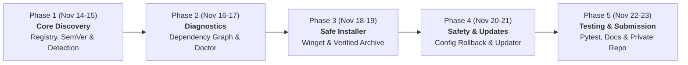

# Implementation Roadmap: eSim ToolCare
## Phase-Wise, Step-by-Step Execution Plan

**Project:** eSim ToolCare — Automated Tool, Dependency & Configuration Manager for eSim  
**Screening Task:** FOSSEE eSim Semester Long Internship – Autumn 2026 (Task 5)  
**Target Deadline:** November 23, 2026  
**Document Version:** 1.0.0  
**Status:** Active Execution Plan  

---

## 1. Executive Timeline & Visual Workflow

The development plan spans 10 days (November 14 to November 23, 2026) divided into 5 distinct phases. Each phase builds upon the previous one with automated testing verification gates.

---

## 2. Phase-by-Phase Detailed Breakdown

### Phase 1: Foundation, Declarative Schema & Discovery Engine (Days 1–2: Nov 14–15)
*Objective: Build the immutable baseline for tool specifications, semantic version comparisons, and non-invasive binary resolution.*

* **Step 1.1: Architecture & Requirements Freeze**
  * Finalize the requirements traceability matrix against FOSSEE Task 5 requirements.
  * Establish clear non-interference boundaries between existing eSim source code (`src/`, `windows/`, `Ubuntu/`) and ToolCare (`toolcare/`).
* **Step 1.2: Declarative Tool Registry Schema & Verified Catalog (`data/tools.json`, `core/registry.py`)**
  * Implement `tools.json` adhering to schema 2.0.0.
  * Populate verified metadata from `windows/deps-manifest.json` and `PACKAGING.md` (Ngspice 45.2, KiCad 9.0.3, Icarus Verilog v12).
  * Explicitly flag unverified fields as `UNVERIFIED` (preventing invented package IDs or hashes).
  * Implement `ToolRegistry` and `ToolSpec` dataclasses.
* **Step 1.3: Robust Semantic Version Parser & Boundary Evaluator (`core/version.py`)**
  * Implement numeric tuple extraction (`parse_version_tuple`) to parse non-standard EDA version strings (`"45.2"`, `"v12-20220611"`, `"9.0.3"`).
  * Implement `compare_versions(v1, v2) -> int` supporting arbitrary component depths.
  * Implement `evaluate_compatibility(detected, spec)` categorizing states into `NOT_INSTALLED`, `VERSION_UNKNOWN`, `INCOMPATIBLE_OLD`, `INCOMPATIBLE_NEW`, `UPGRADE_AVAILABLE`, and `COMPATIBLE`.
* **Step 1.4: Multi-Tier Binary Discovery Engine (`core/detector.py`, `platform_utils.py`)**
  * Implement precedence-based discovery: Environment Variables (`ESIM_NGSPICE`) $\rightarrow$ eSim Config (`~/.nghdl/config.ini`) $\rightarrow$ Bundled folders $\rightarrow$ Standard OS locations $\rightarrow$ System `$PATH`.
  * Implement safe execution with `creationflags=CREATE_NO_WINDOW` and `SW_HIDE` on Windows (zero terminal window flashing).
* **Step 1.5: Unit Test Validation for Phase 1**
  * Write and run `test_registry.py` (schema validation, regex compilation, unverified flag handling).
  * Write and run `test_version.py` (SemVer edge cases, comparison ordering, boundary evaluation).
  * Write and run `test_detector.py` (mocked filesystem discovery and precedence checks).

---

### Phase 2: Flow Dependency Resolution & Diagnostic Doctor Engine (Days 3–4: Nov 16–17)
*Objective: Implement workflow-based dependency auditing and deep runtime health checks (shared libraries, compiler backends).*

* **Step 2.1: Simulation Flow Dependency Mapping (`core/dependency.py`)**
  * Map eSim simulation flows (`simulation`, `verifier`, `dcosim`, `ngveri`, `nghdl`) to required tool IDs.
  * Implement `DependencyGraph.evaluate_flow()` to check whether all tools for a given flow are installed and compatible.
  * Implement `get_dependent_flows(tool_id)` to trace the impact of missing or outdated tools.
* **Step 2.2: Deep Runtime Diagnostic Doctor Implementation (`core/doctor.py`)**
  * Build the 5-stage health auditor mirroring and extending `src/maker/ToolchainCheck.py`.
  * Stage 1: Host environment audit (OS, architecture, package manager availability).
  * Stage 2: Analog simulation audit (`ngspice` binary and code models directory).
  * Stage 3: Digital simulation audit (`iverilog`, `vvp`, `verilator`).
  * Stage 4: VHDL & compiler audit (`ghdl`, `llvm`/`clang`).
  * Stage 5: Configuration files audit (`~/.nghdl/config.ini`, `~/.esim/config.ini`, KiCad `sym-lib-table`).
* **Step 2.3: Critical Sub-Component Linkage Probes**
  * Probe for `libvvp.so` / `libvvp.dll` in Icarus Verilog library paths (vital for `d_cosim`).
  * Probe for `ivlng.so` and `ghdl.cm` code models in Ngspice's code-model directory.
* **Step 2.4: GHDL Backend Trap Protection**
  * Run `ghdl --version` and analyze output text.
  * Flag critical failure if `mcode` backend is detected, recommending installation of `ghdl-llvm`.
* **Step 2.5: Doctor Diagnostic Unit & Mock Tests**
  * Write and run `test_dependency.py` (flow dependency validation and failure cascades).
  * Write and run `test_doctor.py` (mocking missing `libvvp`, missing `ivlng`, and `mcode` GHDL backend).

---

### Phase 3: Multi-Tier Safe Installer & Anti-Tamper Extraction Engine (Days 5–6: Nov 18–19)
*Objective: Build verified package manager wrappers and an archive extraction engine protected against Zip-Slip and corrupted payloads.*

* **Step 3.1: Extensible Package Adapter Base Architecture (`adapters/base.py`)**
  * Define `BaseAdapter` abstract interface with `is_available()`, `install()`, `uninstall()`, and `update()`.
* **Step 3.2: Windows Package Manager (Winget) Adapter Implementation (`adapters/winget_adapter.py`)**
  * Implement subprocess argument list execution for `winget install --id <id> --exact --accept-package-agreements`.
  * Support `--dry-run` to preview commands without execution.
* **Step 3.3: Direct Verified Archive Deployment Engine (`adapters/archive_adapter.py`)**
  * Implement streaming HTTP/HTTPS download with chunked hash computation (`download_staged`).
  * Implement cryptographic SHA-256 integrity verification against pinned hashes from `tools.json`.
  * Immediate abort and cleanup if checksum does not match.
* **Step 3.4: Anti-Zip-Slip Path Traversal Protection**
  * Implement canonical destination path checks for every archive member (`.zip`, `.tar.gz`, `.tar.xz`).
  * Raise `SecurityError` and halt extraction if any path attempts traversal (`../`).
  * Extract strictly inside temporary staging directories (`tempfile.mkdtemp`) prior to final placement.
* **Step 3.5: Primary Target Installation & Post-Install Verification Demonstration**
  * Execute one real supported installation workflow on Windows (e.g. Ngspice 45.2 archive).
  * Automatically run post-installation verification probe to ensure the binary is runnable.

---

### Phase 4: Configuration Safety, Rollback & Dedicated Update Engine (Days 7–8: Nov 20–21)
*Objective: Automate eSim integration, file backups, atomic writes, update planning, and CLI dispatching.*

* **Step 4.1: Pre-Modification Backup & Timestamped Archiving (`core/config_handler.py`)**
  * Implement `create_backup(target_path)` creating `~/.esim/backups/<ISO_TIMESTAMP>/<filename>.bak`.
  * Implement `rollback(timestamp)` to restore verified backups upon failure.
* **Step 4.2: Atomic Configuration Writes & User Setting Preservation**
  * Implement `atomic_write(filepath, content)` using temporary sibling files and `os.replace`.
  * Preserve existing user preferences and comments when parsing INI or S-expression files.
* **Step 4.3: KiCad `sym-lib-table` & Ngspice `spinit` Automated Synchronization**
  * Implement `register_esim_kicad_symbols()` to inject eSim symbol libraries without inserting duplicate rows.
  * Implement `configure_ngspice_spinit()` to set up `codemodel` paths safely.
  * Implement `sync_nghdl_config()` to write detected binary paths into `~/.nghdl/config.ini` (`[COSIM]`, `[NGHDL]`, `[COMPILER]`).
* **Step 4.4: Dedicated Update Planning & Interactive Execution (`core/updater.py`)**
  * Implement `plan_update(tool_id)` generating immutable `UpdatePlan` objects.
  * Implement `--check` (read-only version inspection) and `--dry-run` (action preview).
  * Implement interactive confirmation prompt requiring explicit `y` before executing changes.
  * Record update history and failures in `~/.esim/logs/update_history.json`.
* **Step 4.5: Lightweight CLI Implementation (`cli.py`, `__main__.py`)**
  * Implement lightweight subcommands using Python's standard library `argparse`:
    * `toolcare list [--category CAT]`
    * `toolcare check [TOOL]`
    * `toolcare doctor [--flow FLOW]`
    * `toolcare install TOOL [--method METH] [--dry-run]`
    * `toolcare update [TOOL] [--check] [--dry-run]`
    * `toolcare configure [--sync] [--rollback TIME]`
    * `toolcare logs [--lines N]`

---

### Phase 5: Verification, Packaging, Demonstration & FOSSEE Submission (Days 9–10: Nov 22–23)
*Objective: Execute complete test suite, generate execution guides, package the repository, and submit.*

* **Step 5.1: Automated Pytest Suite Execution & Coverage Measurement**
  * Execute complete `pytest` test suite covering all modules.
  * Measure code coverage and confirm zero unexpected regressions.
* **Step 5.2: Generate `docs/EXECUTION_GUIDE.md` and `docs/DEMO_RESULTS.md`**
  * Document exact setup and step-by-step reproduction commands.
  * Capture and record actual console execution outputs for `list`, `check`, `doctor`, `install`, and `update`.
* **Step 5.3: Package Code & Artifacts into Private GitHub Repository**
  * Initialize clean standalone private repository containing `toolcare/`, `DESIGN_DOCUMENT.md`, `README.md`, and test suite.
  * Ensure no temporary build files or unverified artifacts are tracked.
* **Step 5.4: Grant Private Access to Official Evaluator**
  * Grant private repository read access to `https://github.com/Eyantra698Sumanto` as required by official FOSSEE submission guidelines.
* **Step 5.5: Final Submission Email to `contact-esim@fossee.in`**
  * Compose and send submission email with subject line:
    `eSim Semester Long Internship - Autumn 2026 Submission Task 5`
  * Include private repository link, design document reference, and demo summary.

---

## 3. Milestone & Verification Checklist

| Milestone ID | Target Date | Deliverable Artifacts | Acceptance Criteria |
| :--- | :--- | :--- | :--- |
| **M1** | Nov 15 | `data/tools.json` `core/registry.py` `core/version.py` `core/detector.py` | • Registry validates schema 2.0.0 without errors. • SemVer comparator parses standard and non-standard strings. • Detector correctly locates system binaries. |
| **M2** | Nov 17 | `core/dependency.py` `core/doctor.py` | • Doctor probes 5 stages and outputs aligned reports. • Flags missing `libvvp` and `ivlng` code-models. • Flags `ghdl-mcode` backend as incompatible. |
| **M3** | Nov 19 | `adapters/winget_adapter.py` `adapters/archive_adapter.py` `core/installer.py` | • Archive adapter rejects corrupted SHA-256 hashes. • Anti-Zip-Slip blocks path traversal attempts. • At least one tool successfully installed and verified. |
| **M4** | Nov 21 | `core/config_handler.py` `core/updater.py` `cli.py` | • Pre-modification backups created before file writes. • Atomic writes prevent file corruption. • CLI runs `list`, `check`, `doctor`, `update`, `install`. |
| **M5** | Nov 23 | `docs/TESTING.md` `docs/EXECUTION_GUIDE.md` Private GitHub Repo | • All automated tests executed and passing. • Private repository access granted to `Eyantra698Sumanto`. • Formal submission email sent to FOSSEE team. |
